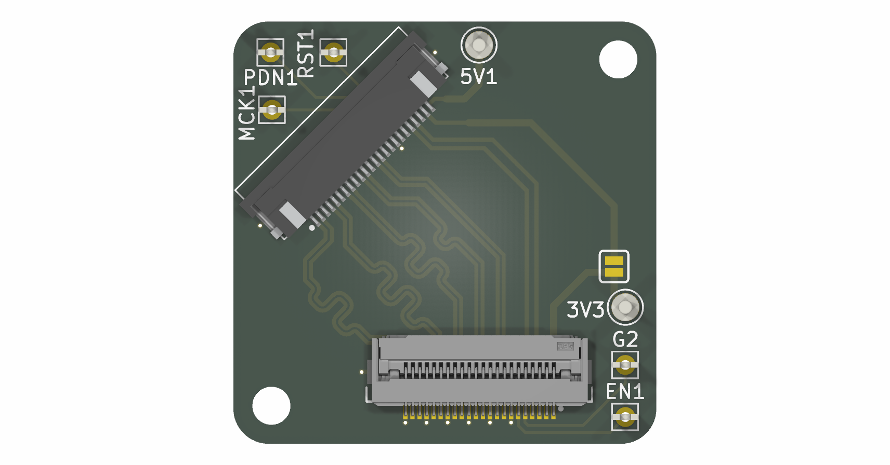
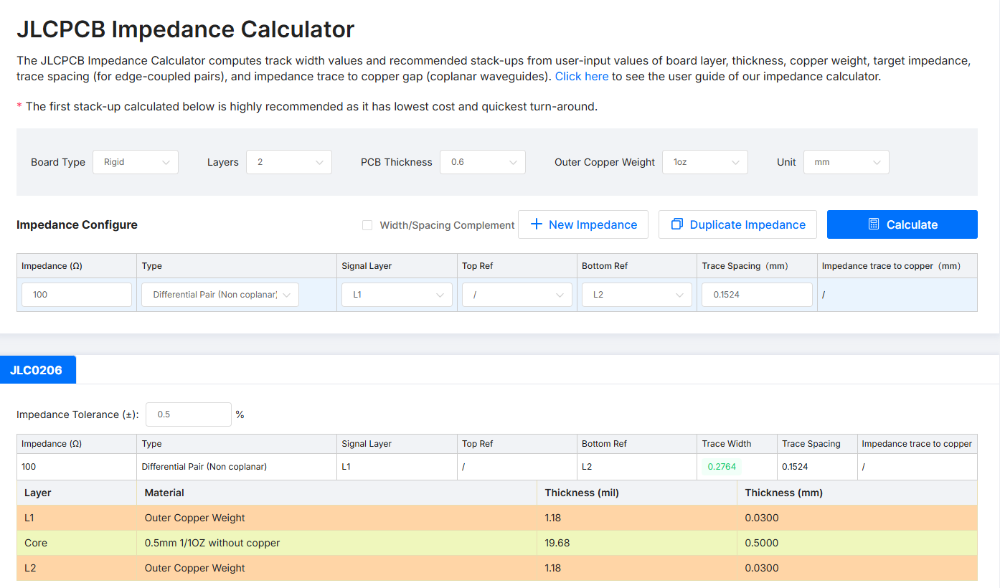

# MYiR_Camface
This is a PCB to interface regular 22-pin MIPI cameras to the 24-pin MYiR dev boards. 

## PCB Render

## Impedance Calculation

Differential impedance for the MIPI CSI pairs, calculated with the JLCPCB impedance calculator.

